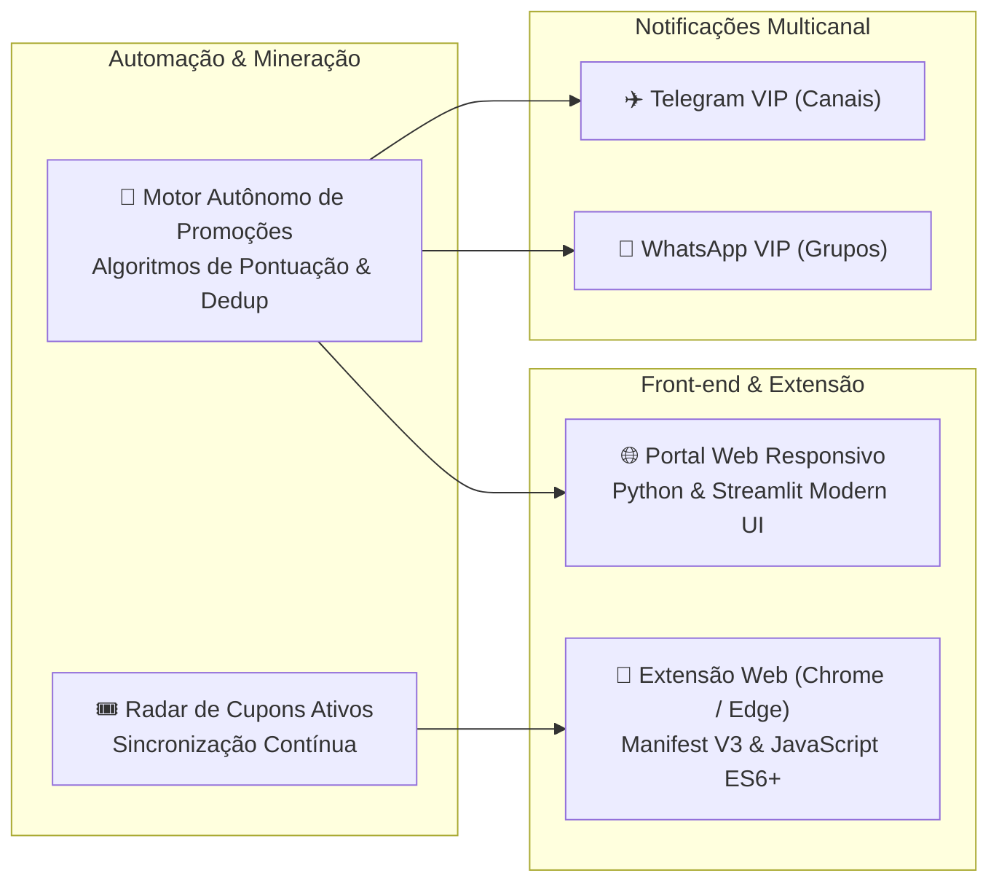

# 🛍️ Radar de Cupons & Ofertas — Mercado Livre

Uma solução completa de inteligência de compras e automação de descontos para o **Mercado Livre**, combinando:
1. **Extensão de Navegador** para testagem automática e aplicação em lote de cupons no carrinho de compras.
2. **Radar de Ofertas 24/7** com catalogação em tempo real e vitrine web responsiva.
3. **Transmissão Multicanal** automatizada para comunidades no **WhatsApp** e **Telegram**.

---

## 🔗 Links Oficiais do Ecossistema

| Canal / Recurso | Descrição | Link de Acesso |
| :--- | :--- | :--- |
| 🌐 **Portal Web Central** | Vitrine ao vivo com ofertas garimpadas, filtros por categoria e cupons ativos | [Acessar Portal Web](https://afiliados-hub.onrender.com) |
| 💬 **Grupo VIP WhatsApp** | Alertas instantâneos de promoções relâmpago e cupons de alta conversão | [Entrar no Grupo WhatsApp](https://chat.whatsapp.com/LRl2PBcMKtd9fLEL3dpWDM?s=cl&p=a&mlu=4&ilr=4) |
| ✈️ **Canal VIP Telegram** | Transmissão de bugs de preço, lista diária consolidada e histórico de descontos | [Entrar no Canal Telegram](https://t.me/achadinhos_vip_br) |
| 📥 **Extensão de Navegador** | Pacote de instalação da extensão para Google Chrome e Microsoft Edge | [Download Direto (.zip v1.1.0)](https://github.com/OhXyytVictor/radar-cupons-mercadolivre/releases/download/v1.1.0/radar-cupons-extension-v1.1.0.zip) |

---

## 🧩 O Que Faz a Extensão de Navegador?

A extensão **Radar de Cupons & Ofertas** foi projetada para resolver a maior dor do comprador online: a frustração de testar cupons manuais inválidos ou expirados no checkout.

* 🚀 **Testador Automático no Carrinho:** Detecta quando o modal nativo de cupom do Mercado Livre é aberto e testa sequencialmente todos os cupons disponíveis com cadência segura (1.6s por código), acumulando benefícios e aplicando o maior desconto.
* ⚡ **Preenchimento com 1 Clique:** Sugestões inteligentes integradas diretamente na caixa de cupom do site. Clicar em qualquer cupom preenche e submete instantaneamente.
* <s>CUPOM</s> ✓ **Histórico por Máquina:** Cupons que já foram testados no seu computador ficam automaticamente riscados com um selo visual de verificação, evitando repetições desnecessárias.
* 🎛️ **Controles Discretos:** Possui botões dedicados de **minimizar (`−`)** para uma pílula sutil no canto e de **fechar (`×`)**, garantindo que nada fique na frente do seu resumo de compra.
* 🤝 **Apoio Transparente ao Desenvolvedor:** Na visualização de produtos, permite apoiar o criador com comissão oficial sem alterar o preço nem as condições do produto.

---

## 📦 Passo a Passo de Instalação da Extensão

A extensão é baseada na arquitetura **Manifest V3** e é compatível com **Google Chrome, Microsoft Edge, Brave e Opera**.

### 1️⃣ Baixar o Pacote
1. Baixe o arquivo comprimido da extensão:
   👉 **[Baixar radar-cupons-extension-v1.1.0.zip (Download Direto)](https://github.com/OhXyytVictor/radar-cupons-mercadolivre/releases/download/v1.1.0/radar-cupons-extension-v1.1.0.zip)**
2. Localize o arquivo na sua pasta de Downloads, clique com o botão direito e selecione **"Extrair tudo..."** (extraia em uma pasta de fácil acesso, como `Documentos\radar-cupons`).

### 2️⃣ Abrir a Tela de Extensões do Navegador
Abra uma nova aba no seu navegador e digite o endereço correspondente:
* **Google Chrome:** `chrome://extensions`
* **Microsoft Edge:** `edge://extensions`
* **Brave Browser:** `brave://extensions`
* **Opera:** `opera://extensions`

### 3️⃣ Ativar o Modo de Desenvolvedor
* No canto superior direito da tela de extensões, ligue a chave seletora **"Modo do desenvolvedor"** (*Developer mode*).

### 4️⃣ Carregar a Extensão
1. Clique no botão **"Carregar sem compactação"** (no Edge: **"Carregar descompactada"** / *Load unpacked*).
2. Selecione a pasta onde você extraiu os arquivos (a pasta onde está o arquivo `manifest.json`).
3. **Pronto!** O ícone do **Radar de Cupons & Ofertas** estará instalado. Clique no ícone de "quebra-cabeça" na barra do navegador e fixe a extensão para acesso rápido.

---

## 💡 Como Utilizar no Mercado Livre

### 🛍️ Na Página de Qualquer Produto
* Um card discreto aparecerá no canto inferior da tela informando que há cupons e ofertas ativas para a categoria.
* Se desejar ativar as condições especiais e apoiar o projeto, clique em **"⚡ Sim, Gerar Link com Meu ID & Ativar Cupons"**.
* Para ocultar o assistente durante a leitura do anúncio, basta clicar no botão de **minimizar (`−`)**.

### 🛒 No Carrinho de Compras
1. Abra o seu carrinho no Mercado Livre e clique normalmente em **"Inserir código do cupom"**.
2. A suíte do **Radar de Cupons** aparecerá automaticamente:
   - Uma caixa de sugestões integrada diretamente abaixo do campo de código.
   - Um painel no canto superior direito com o status em tempo real.
3. Clique em **"🚀 Testar Todos"**: a extensão preencherá e submeterá cada código automaticamente.
4. Ao final do teste, o cupom com o maior desconto permanecerá aplicado ao seu pedido.
5. Se preferir recolher o painel, clique em **`−`** para transformá-lo em uma pequena pílula (`🎟️ Radar de Cupons`) ou em **`×`** para fechar.

---

## 🛠️ Tecnologias & Engenharia da Solução

* **Extensão de Navegador:** JavaScript moderno (ES6+), Chrome Extensions API (Manifest V3), Content Scripts com injeção segura de DOM, isolamento de eventos e CSS Scoped.
* **Portal Web:** Python 3.11, Streamlit, layout responsivo com visual escuro moderno e cache inteligente de 2ms.
* **Automação & Processamento:** Algoritmos proprietários de deduplicação multifatorial, classificação com *word boundaries* e priorização de compras por impulso.
* **Notificações:** Integração direta com Telegram Bot API e WhatsApp API com controle humanizado de cadência.
* **Infraestrutura:** Docker, Docker Compose, hospedagem contínua na nuvem (Render PaaS).

---

## 🛡️ Segurança, Privacidade e Diretrizes

* **Zero Coleta de Dados Pessoais:** A extensão não armazena nem transmite senhas, dados de cartão de crédito ou informações de endereço.
* **Armazenamento Local:** Apenas a lista de códigos já testados na máquina é gravada via `chrome.storage.local` para otimizar o uso do comprador.
* **Conformidade com E-commerce:** A cadência de testes segue limites rigorosamente seguros e compatíveis com a navegação humana, protegendo contra banimentos ou bloqueios temporários de IP.

---

## 👨‍💻 Desenvolvedor & Portfólio

Projeto concebido e desenvolvido por **Victor Ramos**.

* 💼 **GitHub:** [@OhXyytVictor](https://github.com/OhXyytVictor)
* 🌐 **Projetos & Portfólio:** [Victor Ramos Portfolio](https://github.com/OhXyytVictor/Victor-Ramos-Portfolio)
* 📬 **Contato:** jsvramos@live.com

---

  Desenvolvido com foco em engenharia de conversão, automação autônoma e conformidade oficial.

